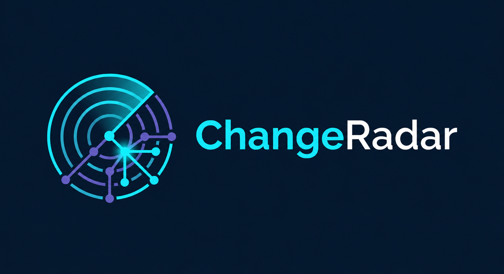

<div align="center">



# ChangeRadar

**Explainable code-change impact analysis for CI/CD.**

[](https://github.com/AnikethTS/ChangeRadar/actions/workflows/ci.yml)
[](LICENSE)

[](build.gradle.kts)
[](gradle/wrapper)
[](docs/ci-integration.md)

</div>

If we merge this change, what else might it affect — and what should we
verify before release?

ChangeRadar reads a Git diff, traces what the change may touch, recommends
relevant tests, and writes the evidence as a report you can run locally or
as a step in the pipeline you already have. It does not replace GitHub
Actions, GitLab CI, Jenkins, your test runner, or your deploy tooling. It
adds impact intelligence to those systems.

**Status:** `0.1.0` — Java, TypeScript/JavaScript, Python, and PHP impact
reports, optional `--policy`, and a GitHub Actions example that uploads
artifacts and comments on same-repo PRs. Limitations stay in the report
instead of implying a complete graph.

## Quick start

```bash
git clone https://github.com/AnikethTS/ChangeRadar.git && cd ChangeRadar
./run.sh analyze --base HEAD~1 --head HEAD --format terminal,markdown,json --output build/changeradar
```

That builds the CLI with the Gradle Wrapper (JDK 21+), compares two
revisions of the current repo, prints a terminal summary, and writes
`build/changeradar/report.md` plus `report.json`.

Machine not ready yet? You need Git and a JDK 21 or newer. Then
`./gradlew check` should pass on a clean checkout. See
[Development](docs/development.md) for the full layout.

## Sample report

```text
ChangeRadar 0.1.0
schema 1.0.0
base   HEAD~1
head   HEAD

Changed files (1)
  MODIFY  src/Demo.java

Changed symbols (1)
  MODIFY  method  Demo#n  src/Demo.java:1

Policy  none blocking

Exit 0 means analysis completed, not that the change is safe.
```

A suggested test will never be phrased as “this test failed” unless
ChangeRadar actually ran it — and the MVP does not run tests.

## Why this exists

Pipelines already build and test according to whatever steps you configured.
They rarely explain the blast radius of *this* diff: which callers move,
which tests are related, whether a public signature changed, or why the
tool is unsure. ChangeRadar exists to make those questions answerable in
the same place you already review the change.

## What it does

- Compares explicit `--base` and `--head` Git refs (SHAs or branch names).
- Lists changed files, including additions, edits, deletions, and renames.
- Maps changed Java lines to types and methods (JavaParser).
- Maps changed TypeScript/JavaScript lines to classes, functions, and
  exports (not tsc).
- Maps changed Python lines to classes and functions (not CPython).
- Maps changed PHP lines to classes and functions (not php-parser).
- Finds likely callers and related tests, labeled DIRECT, INDIRECT, or
  HEURISTIC. Java callers of callers are INDIRECT (capped). Java also
  reports overrides, field reads, annotation uses, and inject-style
  fields.
- Flags public Java members and exported TS/JS symbols on changed lines.
- Writes **terminal**, **Markdown**, and **JSON** reports with a stable
  schema version.
- Distinguishes a completed analysis (`0`), a configured policy violation
  (`1`, only with `--policy`), and a tool/input failure (`2`).
- Records limitations in the report instead of pretending the graph is
  complete.

Still to come: richer binary-compatibility checks. See the
[roadmap](docs/architecture.md#roadmap).

Curious how the pieces fit? [Architecture](docs/architecture.md) and
[How analysis is limited](docs/analysis-limitations.md).

## What it is not

- Not a diff viewer, generic dashboard, linter, or vulnerability scanner.
- Not a replacement for running tests, human review, or other static
  analysis.
- Not a guarantee that a change will break something — or that it will not.
- Not a deployment platform. It never deploys, rolls back, or skips the
  full test suite based on a heuristic score.

## CI/CD

The CLI is the interface. Provider integrations wrap it; they should not
reimplement analysis.

```bash
./run.sh analyze \
  --base "$BASE_SHA" \
  --head "$HEAD_SHA" \
  --format markdown,json \
  --output build/changeradar
```

| Exit code | Meaning |
| --- | --- |
| `0` | Analysis completed; no enabled blocking policy was violated. |
| `1` | A configured blocking policy was violated. |
| `2` | Analysis failed, or input/configuration was invalid. |

A high heuristic risk score must not fail the job unless a team explicitly
enables that policy. A failed analysis is not the same as a detected risk.

A least-privilege GitHub Actions example lives in
[`examples/github-actions/impact.yml`](examples/github-actions/impact.yml).
This repository runs the same workflow and posts (or updates) one PR
comment with `report.md` on same-repo pull requests. Fork PRs skip the
comment job. Comments come from github-actions[bot]; the ChangeRadar logo
is in the comment body. Details: [CI integration](docs/ci-integration.md).

## Docs

- [Architecture](docs/architecture.md) — layers, tradeoffs, roadmap
- [CI integration](docs/ci-integration.md) — exit codes, artifacts, GitHub Actions
- [Analysis limitations](docs/analysis-limitations.md) — what static analysis cannot claim
- [Policy configuration](docs/policy-configuration.md) — `--policy`, fail-open vs fail-closed
- [Development](docs/development.md) — tests, modules, formatting
- [Adding a language analyzer](docs/adding-a-language-analyzer.md)
- [Adding a CI provider](docs/adding-a-ci-provider.md)
- [CONTRIBUTING.md](CONTRIBUTING.md) — how to send a PR
- [SECURITY.md](SECURITY.md) — how to report a vulnerability

## License

MIT — see [LICENSE](LICENSE).
